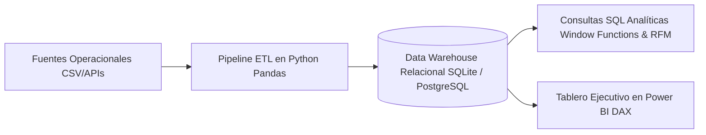

# Pipeline ETL Automatizado y Dashboard Ejecutivo de Inteligencia de Negocios

[](https://www.python.org/)
[](https://www.postgresql.org/)
[](https://powerbi.microsoft.com/)

**Autor:** Gustavo Bryan López Cosme  
**Institución:** Universidad Nacional de Ingeniería (FIIS UNI)

---

## 📌 Descripción del Proyecto
Solución integral de **Data Engineering & Business Intelligence** que abarca desde la extracción y transformación de datos operacionales heterogéneos mediante Python (Pandas), hasta el modelado dimensional relacional (Esquema en Estrella), análisis con consultas SQL analíticas de alto rendimiento (Window Functions, CTEs, RFM) y visualización gerencial interactiva en Power BI con medidas DAX.



## 🧠 Estructura del Esquema Dimensional (Star Schema)
* **Tabla de Hechos:** `fact_ventas` (transaccion_id, fecha_id, cliente_id, producto_id, cantidad, descuento, monto_neto, costo_total, margen_bruto).
* **Tablas de Dimensiones:**
  * `dim_clientes` (cliente_id, nombre, region, tipo_cliente, fecha_registro).
  * `dim_productos` (producto_id, nombre, categoria, precio_unitario, costo_unitario).
  * `dim_tiempo` (fecha_id, fecha, anio, trimestre, mes, nombre_mes, dia, dia_semana).

## 🚀 Capacidades Analíticas Incluidas
1. **Pipeline ETL Automatizado (`etl_pipeline.py`):** Limpieza, imputación, normalización de esquemas y generación de claves sustitutas.
2. **Consultas SQL Avanzadas (`queries_analisis_avanzado.sql`):**
   * Top $N$ productos más rentables por categoría con `DENSE_RANK() OVER (PARTITION BY...)`.
   * Análisis de crecimiento intermensual ($\text{MoM}\%$) con `LAG()` y acumulación progresiva (*Running Total*).
   * Modelo de segmentación de clientes RFM (*Recency, Frequency, Monetary*) utilizando cuartiles `NTILE(4)`.
3. **Cálculos DAX para Power BI (`medidas_dax_powerbi.md`):** Medidas de *Time Intelligence* (YoY, Media móvil a 3 meses) y margen bruto porcentual.

## 🛠️ Ejecución

```bash
# 1. Instalar dependencias
pip install -r requirements.txt

# 2. Ejecutar el pipeline ETL para generar la base dimensional
python etl_pipeline.py

# 3. Explorar las consultas analíticas en SQLite o PostgreSQL
# Las consultas se encuentran documentadas en queries_analisis_avanzado.sql
```
